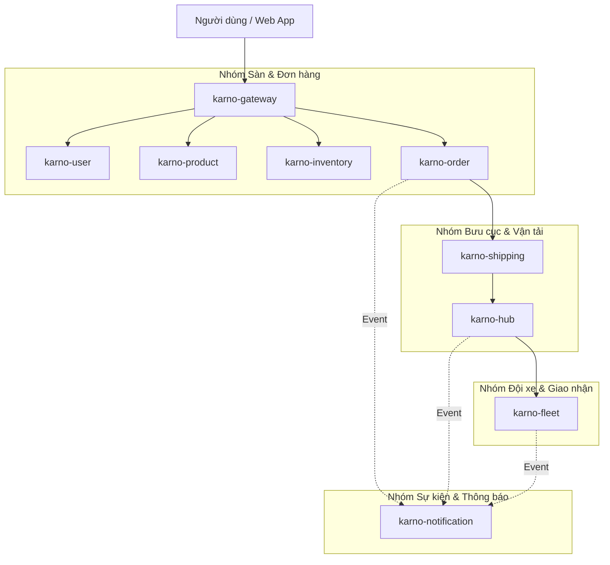

# Karno - E-Commerce & Logistics Microservices System

Hệ thống E-Commerce & Logistics dạng Microservices, hỗ trợ toàn diện chuỗi nghiệp vụ từ sàn thương mại điện tử đến quy trình vận hành bưu cục và điều phối giao nhận thực địa.

---

## 🏗️ Sơ đồ Hoạt động Hệ thống (System Architecture)

Hệ thống bao gồm các microservices độc lập phối hợp xử lý luồng nghiệp vụ E-Commerce & Logistics:

---

## 🛠️ Chi tiết các Dịch vụ trong Hệ sinh thái

Hệ thống bao gồm 9 microservices được phân chia theo các trụ cột nghiệp vụ cốt lõi:

### 🌐 Nhóm Hạ tầng & Cổng vào (Infrastructure)

#### 1. karno-gateway (API Gateway)
* **Bản chất:** Cửa ngõ duy nhất tiếp nhận toàn bộ yêu cầu từ thiết bị người dùng.
* **Nghiệp vụ cốt lõi:**
  * **Điều phối yêu cầu:** Tự động chuyển hướng yêu cầu của người dùng tới đúng dịch vụ xử lý bên trong.
  * **Kiểm soát truy cập:** Xác thực thông tin người dùng trước khi cho phép thực hiện thao tác trên hệ thống.
  * **Bảo vệ hệ thống:** Chống truy cập spam và chia sẻ tài nguyên an toàn.

#### 2. karno-notification (Tự động hóa Thông báo)
* **Bản chất:** Dịch vụ gửi thông tin cập nhật tự động tới người dùng.
* **Nghiệp vụ cốt lõi:** Gửi thư điện tử (Email), tin nhắn (SMS) hoặc thông báo trên màn hình ứng dụng cho khách hàng và tài xế mỗi khi có thay đổi về trạng thái đơn hàng.

---

### 🛍️ Nhóm Sàn & Quản lý Đơn hàng

#### 3. karno-user (Tài khoản & Xác thực)
* **Bản chất:** Quản lý thông tin tài khoản và quyền hạn của thành viên.
* **Nghiệp vụ cốt lõi:** Đăng ký, đăng nhập tài khoản; phân quyền sử dụng hệ thống dựa trên vai trò (Khách mua, Người bán, Tài xế, Nhân viên bưu cục, Quản trị viên); quản lý danh sách địa chỉ giao nhận hàng.

#### 4. karno-product (Danh mục & Quy cách Đóng gói)
* **Bản chất:** Quản lý thông tin hàng hóa của các cửa hàng.
* **Nghiệp vụ cốt lõi:**
  * Quản lý thông tin chi tiết sản phẩm, phân loại danh mục, kích cỡ, màu sắc và giá bán.
  * **Đặc tính phục vụ Logistics:** Ghi nhận trọng lượng và kích thước đóng gói của sản phẩm làm cơ sở tính toán cước phí vận chuyển.

#### 5. karno-inventory (Quản lý Tồn kho)
* **Bản chất:** Quản lý số lượng hàng hóa còn lại trong kho của cửa hàng.
* **Nghiệp vụ cốt lõi:**
  * **Kiểm soát số lượng bán:** Ngăn chặn việc nhiều người cùng mua vượt quá số lượng hàng thực tế còn lại tại một thời điểm.
  * Tạm giữ số lượng hàng khi khách tạo đơn và hoàn lại kho nếu giao dịch mua hàng không thành công.

#### 6. karno-order (Quản lý Vòng đời Đơn hàng)
* **Bản chất:** Quản lý và theo dõi toàn bộ trạng thái đơn hàng.
* **Nghiệp vụ cốt lõi:**
  * Quản lý giỏ hàng và thanh toán đặt hàng.
  * **Theo dõi trạng thái đơn:** Quản lý quá trình chuyển trạng thái đơn hàng từ lúc tạo mới, đang gom hàng, đã vào bưu cục, đang vận chuyển, cho đến khi giao thành công hoặc bị hủy.
  * Ghi nhận lịch sử chi tiết thời gian xử lý đơn hàng.

---

### 🚚 Nhóm Bưu cục & Mạng lưới Vận tải

#### 7. karno-shipping (Tính cước & Định tuyến Mạng lưới)
* **Bản chất:** Xử lý cước phí và lựa chọn lộ trình chuyển hàng.
* **Nghiệp vụ:**
  * **Tính cước tự động:** Tự động tính phí vận chuyển dựa trên khoảng cách địa lý, trọng lượng thực hoặc kích thước quy đổi của hàng hóa.
  * **Định tuyến giao hàng:** Tự động phân loại đơn hàng (nội tỉnh hay liên tỉnh) và tìm kiếm chuỗi bưu cục trung chuyển tối ưu nhất để đưa hàng từ người gửi đến người nhận.

#### 8. karno-hub (Vận hành Bưu cục & Tuyến Xe tải Linehaul)
* **Bản chất:** Quản lý hoạt động phân loại và lưu kho vật lý tại các bưu cục.
* **Nghiệp vụ cốt lõi:**
  * Quét mã mã vạch/QR để thực hiện nhập/xuất kho và sắp xếp vị trí lưu kho của gói hàng.
  * **Gom đơn hàng loạt:** Gom nhiều đơn hàng nhỏ có cùng điểm đến vào một bao hàng lớn để vận chuyển chặng xa.
  * **Quản lý xe tải vận chuyển chặng dài:** Tạo chuyến xe, kiểm soát tải trọng, thể tích xe tải chở hàng liên tỉnh và điều phối xe lăn bánh.

---

### 🛵 Nhóm Đội xe Giao nhận Thực địa

#### 9. karno-fleet (Điều phối Shipper & Tối ưu Lộ trình)
* **Bản chất:** Quản lý nhân viên giao hàng và phương tiện giao nhận thực địa.
* **Nghiệp vụ:**
  * **Giao việc tự động:** Tìm kiếm và điều phối nhân viên giao hàng gần nhất đến lấy hàng tại cửa hàng, hoặc giao hàng đến tận tay người nhận trong khu vực.
  * **Theo dõi vị trí & Tiền thu hộ (COD):** Giám sát vị trí của nhân viên giao hàng và kiểm soát số tiền mặt thu hộ khách hàng.
  * **Tối ưu danh sách điểm dừng:** Tự động sắp xếp trình tự đi qua các địa chỉ giao hàng sao cho quãng đường đi là ngắn nhất, tiết kiệm thời gian nhất cho nhân viên.
